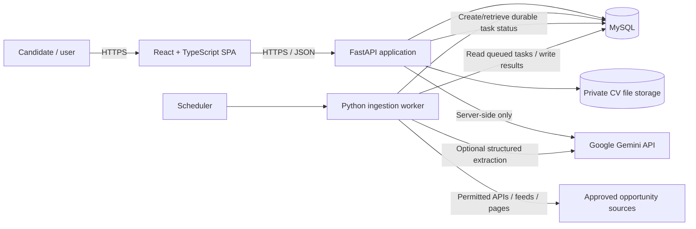
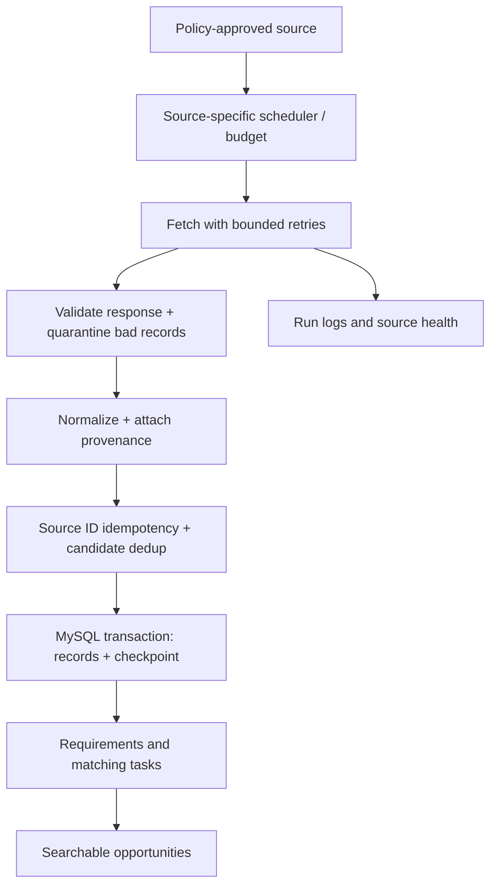

# CareerRadar — Software Architecture

> **Version:** 0.1.0 (initial architecture draft)  
> **Date:** 2026-10-27  
> **Status:** Proposed; subject to iterative review  
> **Related specification:** [`prd.md`](./prd.md)  
> **Purpose:** Define CareerRadar's initial technology decisions, system boundaries, component responsibilities, data flows, security constraints, and points requiring later approval.

---

## 1. Architectural intent

CareerRadar is a **personal career and opportunity intelligence system**. It monitors an approved, user-curated selection of sources, collects **jobs, fellowships/mentorships, and postgraduate scholarships**, and helps a candidate determine eligibility, assess relevance, monitor deadlines, prepare applications, and track progress.

The architecture must support the PRD's distinctions between:

- **Eligibility:** Whether known mandatory criteria are satisfied, not satisfied, or need verification.
- **Relevance:** How well an opportunity aligns with the candidate's skills, interests, and preferences.
- **Provenance:** What the authoritative source actually said, when it was checked, and how trustworthy each extracted claim is.
- **Assistance versus action:** Recommendations are allowed; applications, communications, and CV changes require explicit user action.

**Design approach:** Build a **modular monolith** with independently scheduled ingestion workers. Optimize for correctness, low operating cost, observability, and fast iteration rather than premature distributed-system complexity.

**Initial scope assumption:** One private user, but maintain clear user-ownership boundaries to allow a future multi-user implementation. This is an assumption, not an irreversible commitment.

## 2. Technology decisions and status

| ID | Area | Initial decision | Status | Notes |
|---|---|---|---|---|
| ADR-001 | Frontend | **React + TypeScript** | **Selected by owner** | Browser-based application; use typed API contracts. |
| ADR-002 | Backend | **Python + FastAPI** | **Selected by owner** | REST API, validation, domain services, integration orchestration. |
| ADR-003 | Primary database | **MySQL** | **Selected by owner** | Authoritative relational system of record; replaces PostgreSQL mentioned in the PRD's earlier proposal. |
| ADR-004 | AI provider | **Google Gemini API** | **Selected by owner** | All model-based AI generation, extraction, and possible embeddings use Google Gemini endpoints. |
| ADR-005 | System topology | Modular monolith plus dedicated worker process | Proposed | Shared Python codebase; no microservices initially. |
| ADR-006 | ORM and migrations | SQLAlchemy 2.x + Alembic | Proposed | MySQL dialect; migration-driven schema changes. |
| ADR-007 | Frontend build/UI | Vite + React Router + a component/styling system | Proposed | Specific UI framework not yet selected. |
| ADR-008 | Scheduling | Dedicated worker + cron or scheduler | Proposed | No reliance on HTTP requests or in-process web-server tasks for durable ingestion. |
| ADR-009 | Local deployment | Docker Compose | Proposed | Frontend, FastAPI, worker, and MySQL; public hosting undecided. |
| ADR-010 | Document storage | Private filesystem or object storage for CV bytes; MySQL for metadata | Proposed | Avoid storing uploaded documents directly in broadly accessible tables. |
| ADR-011 | Search | MySQL indexed filtering and full-text search initially | Proposed | Semantic/vector search is a later, measured decision. |

### Decision rules

1. **Selected by owner** means the technology is a current architectural constraint, not that every library or version has been finalized.
2. **Proposed** means it is a reasonable starting design and can be replaced without changing product requirements.
3. Any change must record the reason, migration impact, testing impact, and related PRD updates in an Architecture Decision Record (ADR).
4. **Architecture overrides conflicting technology suggestions in PRD v0.1.0**: use **MySQL**, not PostgreSQL; use **Google Gemini**, not a local LLM or a different cloud-model provider. Align the PRD during its next revision.

## 3. System context and container architecture



### Container responsibilities

| Component | Responsibility | Must not do |
|---|---|---|
| React SPA | Profile editing, searches, opportunity detail, application tracker, AI advice display | Hold Gemini keys, directly connect to MySQL, scrape providers, make Gemini API calls |
| FastAPI | Authorization, validation, profile/opportunity APIs, deterministic eligibility/ranking, AI gateway, audit | Execute long recurring crawls inside user request handlers |
| Ingestion worker | Scheduled source polling, normalization, deduplication, verification, durable checkpointing | Bypass source policies or silently mark unseen opportunities closed |
| MySQL | Relational persistence, transactions, durable workflow state, source runs, matching records | Store application secrets or act as an unbounded raw-page archive |
| Private document storage | Uploaded CV/DOCX/PDF bytes and optionally generated drafts | Expose files as public static assets |
| Gemini API | Model-based extraction, classification, explanation, CV guidance, optional embeddings | Make eligibility decisions without validated evidence or automatically submit applications |

**Topological constraint:** Frontend requests terminate at FastAPI. Gemini credentials, source access credentials, database credentials, and policy checks stay exclusively on the backend/worker side.

## 4. Backend architecture: domain modules

A single FastAPI deployment can contain independently testable modules:

| Module | Responsibilities |
|---|---|
| `identity` | Private user context now; authentication/ownership enforcement for deployment and eventual multi-user support |
| `profiles` | CV input, local text extraction, structured candidate evidence, confirmation, edits, preferences |
| `sources` | Curated source registry, access policy, credentials, polling budgets, health |
| `ingestion` | Source adapters, fetch, parse, normalization, checkpoint, retries, dedup, reconciliation |
| `opportunities` | Common opportunities; job, fellowship, scholarship details and application cycles |
| `requirements` | Canonical hard/preferred requirements, field provenance and uncertainties |
| `matching` | Deterministic eligibility rules, relevance ranking, persisted reasoning and scores |
| `ai` | Gemini client abstraction, prompt templates, typed responses, safety filters, usage accounting |
| `applications` | Bookmarks, application pipeline, reminders, history, CV version association |
| `notifications` | Deduplicated in-app alerts; email integration only if later approved |
| `audit` | Security-sensitive actions, data changes and processing diagnostics |

**Module boundary rule:** Source adapters do not call HTTP endpoints within the same app; domain services are invoked directly. Modules exchange typed domain objects, not raw provider-specific JSON. Database model classes and API schemas are distinct.

## 5. Frontend architecture

**Chosen:** React and TypeScript. **Proposed:** Vite for build/dev workflow, React Router for routes, TanStack Query (or equivalent) for server-state caching, and a shared component library.

Proposed screens:

1. **Dashboard:** Recommended opportunities, eligibility state, new matches, upcoming verified deadlines, source health.
2. **Discover:** Search/filter by type, career field, skills, geography, funding, seniority, status, and source.
3. **Opportunity detail:** Original listing, attribution, eligibility reasoning, match breakdown, deadline provenance, application link.
4. **Profile:** Upload/paste CV, confirm extracted claims, manage evidence and preferences.
5. **Application advisor:** Role-specific, fact-checked CV tailoring suggestions and user-approved draft versions.
6. **Application tracker:** Saved → preparing → applied → interview → offer/rejected/withdrawn, with notes and history.
7. **Source manager:** Enable reviewed source adapters, inspect sync timestamps, inspect errors and policy states.
8. **Settings:** Gemini usage and privacy choices, notification preferences, profile/document deletion.

TypeScript domain types should be generated from FastAPI's **OpenAPI schema** (or another enforced shared contract) rather than duplicated manually. External content must be rendered as sanitized text/HTML. Never insert untrusted HTML into React without an explicit sanitizer and threat review.

## 6. Data architecture: MySQL

**Selected:** MySQL is the authoritative persistent data store. **Proposed implementation:** InnoDB transactional tables, `utf8mb4`, SQLAlchemy ORM, and Alembic migrations. If using asynchronous sessions, evaluate `asyncmy` or `aiomysql` as supported SQLAlchemy MySQL drivers; driver choice remains open.

### Primary entities

| Table / aggregate | Key purpose |
|---|---|
| `users` | Ownership boundary, even for a single-user MVP |
| `candidate_profiles` | Confirmed profile revisions and metadata |
| `candidate_evidence` | Skills, education, work history, certifications, projects, user confirmation, source evidence |
| `documents` | Private file pointer, MIME, hash, owner, retention/deletion status; **not publicly served** |
| `career_preferences` | Desired roles, countries, work type, sponsorship, funding and academic interests |
| `sources` / `source_policies` | Connector configuration, permitted usage, attribution, retention and last policy review |
| `source_runs` / `source_records` | Polling status, checkpoints, external IDs, allowed retained data and record fingerprints |
| `opportunities` | Shared identity/type/title/provider/canonical URL/status fields |
| `application_cycles` | Distinct annual/cohort/reopening cycles with independently verified dates |
| `job_details`, `fellowship_details`, `scholarship_details` | Opportunity-type-specific criteria and benefits |
| `opportunity_sources` | Multiple original source references to one logical opportunity |
| `requirements` / `field_evidence` | Hard/preferred requirements with provenance and verification status |
| `match_results` / `requirement_assessments` | Eligibility status, score, reasons, profile/model/rule versions |
| `saved_opportunities` / `applications` / `application_events` | Per-user workflow and application event history |
| `ai_tasks` / `ai_usage` | Prompt/task version, state, token/cost tracking, errors, result pointer; minimal metadata |
| `notifications` / `audit_events` | Deduplicated delivery, critical change history |

### Data integrity and date conventions

- Use foreign keys, explicit transactions, unique constraints for stable source records, and indexed queries for `(type, status, deadline)`, profile ownership, and source-run health.
- Use stable UUID identifiers where appropriate. UUID storage format (`CHAR(36)` for simplicity versus `BINARY(16)` for efficiency) is **TBD**.
- Distinguish `posted_at`, `first_seen_at`, `last_seen_at`, `last_verified_at`, `opens_at`, and `deadline_at`.
- Persist exact timestamps normalized to **UTC** plus the original timezone/offset and date precision. **Date-only** deadlines must remain date-only unless an official cutoff time exists; avoid fabricated end-of-day times.
- Represent unknown eligibility, sponsorship, deadlines, and funding explicitly (`UNKNOWN`, `NULL`, or equivalent typed state), never with guessed defaults.
- Add uniqueness to source-origin records: `(source_id, external_id, cycle_key)` where those fields are reliably available. For missing IDs, use a separate fingerprint-based dedup pipeline and manually review ambiguous matches.
- Do not use MySQL JSON columns as a substitute for normalized core relationships. JSON is acceptable for versioned, optional provider-specific attributes subject to source storage permissions.
- **Source retention policy controls persistence:** Do not assume indefinitely storing full job descriptions is allowed.
- Store uploaded CV bytes in a private file store; MySQL holds the owner, version, hash, metadata, and private location reference.

### MySQL-specific reliability requirements

- Use one DB transaction for each committed ingestion batch and its checkpoint update; never advance a cursor ahead of persisted records.
- Reprocessing the same source payload must be **idempotent**.
- Use bounded connection pools, configured connection timeouts, and retry only transient operations whose semantics are safe.
- Handle migration rollback/forward strategy and back up MySQL before destructive migrations.
- Do not treat missing records from a partial API response as confirmed closures.

## 7. Gemini integration strategy

**Owner-selected constraint:** **Every model-based AI capability must use Google Gemini APIs**. This includes generative extraction, classification, explanations, and—if introduced—semantic embeddings via Google's embedding endpoint. **Deterministic Python business rules are not AI-model calls** and remain necessary for safety and reproducibility.

### AI use cases and control boundaries

| Use case | Proposed implementation | Validation/control |
|---|---|---|
| CV interpretation | Local PDF/DOCX text extraction → minimized text sent to Gemini (only when permitted) → structured facts | Pydantic validation; user must confirm claims; original text evidence |
| Opportunity requirement extraction | Allowed source text → Gemini → typed mandatory/preferred/unknown requirements | Source spans and field provenance; reject unsupported assertions |
| Job/fellowship/scholarship classification | Gemini only if simple source/category rules are insufficient | Schema validation and deterministic category constraints |
| Match explanations | Gemini summarizes deterministic eligibility and relevance evidence | Cannot override hard eligibility outcome or invent evidence |
| CV tailoring | Gemini proposes edits using a confirmed candidate profile and actual opportunity requirements | Never invent achievements, credentials, dates, or metrics; human approves changes |
| Semantic similarity (optional) | Gemini embedding endpoint; cache permissible vectors | Model/version tagging; measure benefit before adoption; respect privacy and source policies |

### Gemini gateway contract

Implement a backend-only `GeminiGateway` responsible for:

- Provider SDK/client initialization and server-side API-key management.
- Per-use-case model selection in configuration; **do not hard-code one model into domain services**.
- Defined input schemas and typed/structured output contracts (e.g., Pydantic models).
- Token/context budgets, bounded concurrency, timeouts, request limits, and retry/backoff for eligible transient errors.
- Rate-limit responses (`429`), quota exhaustion, server failures, schema failures and provider outages as distinct error states.
- Cost/usage instrumentation without retaining full sensitive prompts by default.
- Prompt template and model version IDs on stored derived artifacts.
- Explicit controls for Google request storage/logging and data-handling policies.
- Preventing external opportunity content from being interpreted as instructions. Source pages and CV text are **untrusted input**, not system prompts.

**Illustrative service interface (architecture sketch, not frozen SDK code):**

```python
class GeminiGateway(Protocol):
    async def extract_requirements(self, source_text: str, context: dict) -> dict: ...
    async def extract_candidate_facts(self, sanitized_text: str) -> dict: ...
    async def explain_match(self, verified_evidence: dict) -> dict: ...
    async def suggest_cv_edits(self, verified_evidence: dict) -> dict: ...
```

**Recommended operation:** Use Gemini's structured output functionality where supported, then validate responses locally. Even schema-valid responses are **not proof of factual accuracy**. For initial noninteractive analysis, use stateless content-generation requests; API choice/model names should be verified when implementation begins.

### Critical Gemini privacy decision — must be resolved before sending actual CVs

Google's Gemini API terms distinguish **unpaid** and **paid** services. The unpaid terms say submitted content can be used to improve Google's products and may be reviewed; they advise against sending personal/sensitive/confidential data. **Therefore, the system must not transmit identifiable CVs or personal records using an unpaid Gemini API tier.** A billed setup must also be reviewed for contractual/privacy suitability; payment alone is not a substitute for consent and minimization.

Google's **2026-10-26** Gemini logging update states that new eligible paid projects using Generate Content store requests by default unless changed. Before processing personal documents:

1. Confirm the actual Gemini project tier, terms, geography, and data-handling requirements.
2. Configure **request storage/logging off** for sensitive calls where the selected endpoint/SDK supports this; verify the project-level setting and SDK behavior against current documentation.
3. Request explicit consent before sending minimized CV/profile content to Gemini; show what data leaves CareerRadar.
4. Remove unnecessary names, email addresses, telephone numbers, addresses, government IDs, and unrelated personal details before model calls.
5. Never forward Gemini credentials or raw private documents to the browser; avoid sensitive request/response payloads in application logs.
6. Provide a **non-AI/manual fallback** if Gemini is unavailable, the billing/privacy gate is incomplete, or consent is withheld.

**Open decision:** Whether the owner will use a **paid Gemini API project** with appropriate data controls, and how consent/redaction will be implemented. This is a blocker for AI processing of real CVs, not for building the ingestion/database/frontend foundations.

## 8. Eligibility and recommendation architecture

The eligibility engine remains **deterministic and evidence-driven**. Gemini can extract text into candidate facts and requirement candidates, but confirmed facts and versioned rules determine mandatory eligibility.

```text
Approved opportunity record + confirmed candidate profile
    → requirement normalization / source evidence
    → hard-rule eligibility: ELIGIBLE | INELIGIBLE | NEEDS_VERIFICATION
    → relevance scoring: skills, seniority, interests, constraints, freshness
    → Gemini explanation: evidence-backed human-readable rationale
    → persisted, versioned match result
```

Do not substitute a single LLM-produced percentage for an auditable rule evaluation. A relevance score never changes `INELIGIBLE` to `ELIGIBLE`, and absent evidence never becomes an affirmative sponsorship, language, nationality, or funding claim.

All persisted results should include the candidate profile version, opportunity source-version, rule version, optional Gemini model/prompt version, evaluation time, and supporting evidence identifiers. Recompute when relevant inputs change.

## 9. Opportunity ingestion architecture

### Source policy admission

Collection precedence: **approved API → approved RSS/feed → explicitly reviewed public HTML → manual link/text input**. No generic promise to scrape any site. Each source record needs a documented owner, access policy, credentials, attribution, allowed retention, supported collection cadence, pagination, and closure semantics.

**Required ingest sequence:**



### Failure semantics

- **Rate limits:** Honor provider-published limits and `Retry-After`; use exponential backoff and jitter where appropriate; do not attempt evasive scraping.
- **Partial pages or failed sync:** Record `PARTIAL`/`FAILED`; do not close unseen opportunities.
- **Duplicate notices:** Preserve original source references; merge logical opportunities conservatively.
- **Unknown deadlines:** Remain unknown; user-facing text must distinguish posting, discovery, verification, and deadline.
- **Closed/reopened programmes:** Model new application cycles independently; never project last year's deadline forward as confirmed.
- **Source terms change:** Disable connector, stop ingestion, and purge/restrict records when required.
- **Gemini unavailable:** Ingest reliable source facts without AI enrichment; queue/mark extraction as pending rather than dropping opportunities.

## 10. API boundary (provisional)

Base path: `/api/v1`. Endpoints below are suggestions, aligned with the PRD, not yet final contracts.

| Route | Responsibility |
|---|---|
| `POST /profile/import` | Receive PDF/DOCX or pasted text; validate; store privately; create extraction job |
| `GET /profile`, `PUT /profile` | Read, confirm and edit structured evidence |
| `GET /preferences`, `PUT /preferences` | Manage desired roles, geography, funding and restrictions |
| `GET /sources`, `POST /sources` | List and configure policy-reviewed sources |
| `POST /sources/{source_id}/sync` | Request compliant sync; return durable run ID |
| `GET /ingestion/runs/{run_id}` | Read run progress, last successful check and failure details |
| `GET /opportunities` | Filtered and paginated discovery feed |
| `GET /opportunities/{id}` | Evidence, original links, cycle and deadline details |
| `POST /opportunities/manual` | Manually add a reviewed opportunity |
| `POST /opportunities/{id}/assess` | Evaluate eligibility and fit against confirmed profile |
| `POST /opportunities/{id}/advice` | Generate human-reviewed resume suggestions via Gemini |
| `GET /saved`, `POST /saved` | Bookmark an opportunity |
| `GET /applications`, `POST /applications`, `PATCH /applications/{id}` | Track application workflow |
| `DELETE /profile/data` | Delete candidate information/documents under defined retention policy |

Use OpenAPI-generated types, consistent error envelopes, cursor or offset pagination with defined bounds, `202 Accepted` for asynchronous jobs, and strict per-user authorization for all private resources.

## 11. Security, privacy and compliance

| Severity | Risk | Control / expected behavior |
|---|---|---|
| **Critical** | Real CV sent to unsuitable Gemini tier or logged unexpectedly | Preflight billing/terms review, consent, redaction, storage controls, provider-specific privacy tests |
| **Critical** | Candidate incorrectly labeled legally eligible | Hard-rule checks with `NEEDS_VERIFICATION` and evidence; never infer worldwide work permission from “remote” |
| **Critical** | Gemini/source/API secrets exposed | Server-side secret manager or protected environment, no frontend credentials, rotation and leak scanning |
| **Major** | Malicious job page instructs AI to leak data or ignore rules | Untrusted-content isolation, constrained prompts, typed outputs, no arbitrary tool execution |
| **Major** | Arbitrary URL fetch exposes internal network (SSRF) | HTTPS validation, permitted host policies, DNS/IP checks at connection time, blocked private/link-local targets |
| **Major** | Upload abuse, path traversal or malicious content | MIME/signature checks, size limits, private storage, randomized filenames, safe parsers; malware scanning as deployment dictates |
| **Major** | Over-retention or redistribution of source data | Provider-specific retention and attribution enforcement, disable/purge mechanism |
| **Major** | Cross-user disclosure upon future expansion | Ownership-scoped queries, access checks, document authorization and isolation tests |
| **Minor** | Cost spikes from repeated Gemini calls | Caching of permitted results, task deduplication, budgets and model usage telemetry |

**Minimum operational hygiene:** HTTPS in hosted environments; authentication before public exposure; CORS allowlist; CSRF defenses if cookie auth is used; restrictive file permissions; parameterized ORM queries; no plaintext secrets in Git; backups encrypted where applicable; deletion requests propagated to derived data and documented backup retention.

## 12. Deployment and runtime topology

### Initial local deployment (proposed)

```text
Docker Compose
├── web            React static build / development server
├── api            FastAPI HTTP server
├── worker         Python scheduled ingestion and durable task processor
├── mysql          MySQL with named persistent volume
└── private_files  Application-managed private volume

External: approved job/programme sources; Google Gemini API
```

Do **not** launch recurring background collectors as FastAPI `BackgroundTasks` attached to requests or in multiple Uvicorn workers: restarts, duplicate scheduler instances and lack of durable checkpointing can corrupt run semantics. Run exactly one scheduler leader initially, and record task leases/checkpoints in MySQL; add a broker only when reliability/load measurements justify it.

### Environment configuration (names only; never commit values)

```dotenv
DATABASE_URL=mysql+asyncmy://<user>:<password>@mysql:3306/careerradar
GEMINI_API_KEY=<server-only-secret>
GEMINI_TEXT_MODEL=<approved-model-id>
GEMINI_EMBEDDING_MODEL=<optional-approved-embedding-model-id>
GEMINI_DATA_POLICY_APPROVED=false
GEMINI_STORE_REQUESTS=false
FILES_PRIVATE_DIR=/srv/careerradar/private
SOURCE_SYNC_ENABLED=false
APP_ENV=development
```

**Note:** The logging flag is a desired application policy, not evidence that a particular Gemini SDK silently applies it. The gateway must set the supported request/project controls explicitly and verify behavior. Values above are placeholders, not real credentials.

## 13. Reliability, observability and quality gates

### Initial targets — design hypotheses, not guarantees

| Dimension | Provisional target | Verification |
|---|---|---|
| Feed latency | p95 < 500 ms for cached browse on an agreed development dataset; excludes AI calls | API load test |
| Duplicate prevention | No new logical records after identical fixture re-ingestion | Integration tests |
| Source failure safety | Existing opportunities stay intact after partial sync/database failure | Fault injection |
| Eligibility correctness | No known hard disqualifier classified as eligible in a curated golden test suite | Rules and evidence tests |
| Freshness honesty | Every source shows last successful verification; stale state is visible | Clock-controlled UI/API tests |
| Gemini availability | Explicit pending/error states; baseline browsing remains available | Mock 429/timeout/outage |
| Privacy | No private CV payloads or API keys in application logs; no sensitive Gemini call when privacy gate is off | Security/integration tests |
| Database recovery | Successful backup restoration and migration smoke test | Restore drill |

### Testing strategy

- **Unit:** normalization, requirements, eligibility rules, relevance score, date precision, URL canonicalization, redaction.
- **Contract:** provider API fixtures; source-policy enforcement; structured Gemini responses and schema rejection.
- **Integration:** FastAPI ↔ MySQL; transactional checkpoints; profile document metadata/storage; mock Gemini errors.
- **End-to-end:** CV import and confirmation → source ingestion → opportunity assessment → advice → saved/application tracking.
- **Adversarial:** duplicated records, malformed date, unknown visa support, source closure false positives, SSRF URL, malicious prompt-injection listing, unexpected Gemini logging configuration.

Instrument source-run IDs, AI-task IDs, correlation IDs, failure categories, budget usage, and pipeline durations; log metadata, not full private CV contents or raw sensitive prompts.

## 14. Delivery sequence

| Phase | Build focus | Exit condition |
|---|---|---|
| **0 — Foundation/decisions** | Resolve local vs hosted auth, MySQL setup, Gemini privacy/billing gate, first compliant sources | Architecture/PRD consistent; environment reproducible |
| **1 — Skeleton** | React + TypeScript, FastAPI, MySQL, Alembic, Docker Compose, CI | API, frontend and DB work end-to-end |
| **2 — Discovery** | Source registry, one approved connector, normalization, data model, dedup, status and date provenance | Repeated sync is idempotent; source links and timestamps accurate |
| **3 — Candidate profile** | PDF/DOCX/paste input, local parsing, confirmation UI, evidence model | Stored profile matches user-verified facts |
| **4 — Match engine** | Hard eligibility rules and interpretable relevance score | Golden cases pass; unknown restrictions not asserted eligible |
| **5 — Gemini assistance** | Privacy-approved gateway, typed extraction and explanations, CV advisor | Schema tests, human review, rate-limit and outage tests pass |
| **6 — Personal workflow** | Search/filter UI, bookmarks, application tracker, verified deadline status | Complete manual discovery-to-application workflow works |
| **7 — Expansion** | Additional sources, notifications, optional Gemini embeddings, hosting | Evidence-based performance and source compliance review |

Phases may be parallelized where dependencies permit, but the Gemini privacy gate must precede calls containing real candidate personal information.

## 15. Alternatives and trade-offs

| Choice | Why it fits now | When an alternative may be better |
|---|---|---|
| React + TypeScript SPA | Interactive personalized dashboard and mature component ecosystem | Next.js/SSR if public search discoverability, indexing or page rendering becomes central |
| FastAPI modular monolith | Small team, Python data integrations, typed REST API, straightforward tests | Separate services if independent scaling/deployment needs become measurable |
| MySQL | Relational transactions and familiar operational model; selected by owner | PostgreSQL if advanced search/JSON/vector capabilities become core and justify migration |
| Gemini-only AI gateway | One provider interface, consistent usage and cost control | Multi-provider abstraction only if future strategy changes; **not currently in scope** |
| MySQL search first | Simple, low-cost filter/search at MVP size | Dedicated search index for complex ranking or large datasets after measurement |
| In-process code shared with separate worker | Minimal infrastructure with reliable scheduling boundary | Redis/broker-backed queue if durable dispatch scale or concurrency requirements exceed MySQL-backed tasks |

## 16. Open architectural decisions

- **ARCH-01 [Blocker before real CV AI]:** Gemini project billing tier, data-processing terms, logging/storage verification, consent/redaction design.
- **ARCH-02:** Exact Gemini model IDs for extraction/advice and whether embeddings are in scope; verify availability/quotas/pricing before choosing.
- **ARCH-03:** Auth strategy: private local login, hosted single-user login, or multi-user capability.
- **ARCH-04:** CV file storage for deployment: persistent Docker volume versus encrypted object storage; file size/retention limits.
- **ARCH-05:** Initial approved job, fellowship and scholarship sources; each provider's allowed access/retention/polling.
- **ARCH-06:** MySQL major version, deployment provider, connection driver and UUID layout.
- **ARCH-07:** Worker scheduling/lease implementation, notification channel, and expected ingestion scale.
- **ARCH-08:** Frontend routing, styling/components, server-state library, and frontend test runner.
- **ARCH-09:** Minimum data fields for scholarship funding and verified eligibility by opportunity type.
- **ARCH-10:** Hosting, monthly API budget, backup frequency, and recovery expectations.

## 17. Architecture Decision Record (ADR) template

Create new files in `docs/decisions/` as choices evolve; never silently overwrite historical rationale.

```markdown
# ADR-NNN — <decision title>
Status: Proposed | Accepted | Superseded
Date: YYYY-MM-DD
Context: <problem, constraints, evidence>
Decision: <selected approach>
Alternatives: <credible options and trade-offs>
Consequences: <benefits, risks, costs, migration>
Verification: <tests, metrics, primary documentation>
Supersedes: <prior ADR, if any>
```

## 18. Reference documentation and verification notes

External interfaces are version-sensitive. Check primary documentation when implementing; documentation linked below was consulted on **2026-10-27**.

- [Google Gemini API reference](https://ai.google.dev/api)
- [Google GenAI structured outputs](https://ai.google.dev/gemini-api/docs/structured-output)
- [Google Gemini rate limits](https://ai.google.dev/gemini-api/docs/rate-limits)
- [Google Gemini embeddings](https://ai.google.dev/gemini-api/docs/embeddings)
- [Google Gemini API additional terms](https://ai.google.dev/gemini-api/terms)
- [Google Gemini API logs and datasets](https://ai.google.dev/gemini-api/docs/logs-datasets)
- [Google Gemini API release notes](https://ai.google.dev/gemini-api/docs/changelog)
- [SQLAlchemy MySQL dialects](https://docs.sqlalchemy.org/en/20/dialects/mysql.html)
- [FastAPI documentation](https://fastapi.tiangolo.com/)
- [MySQL documentation](https://dev.mysql.com/doc/)

---

**Current architecture baseline:** **React + TypeScript** → **Python/FastAPI** → **MySQL**, with **Google Gemini accessed only through server-side AI services**. Everything else remains explicitly provisional until reviewed and accepted.
