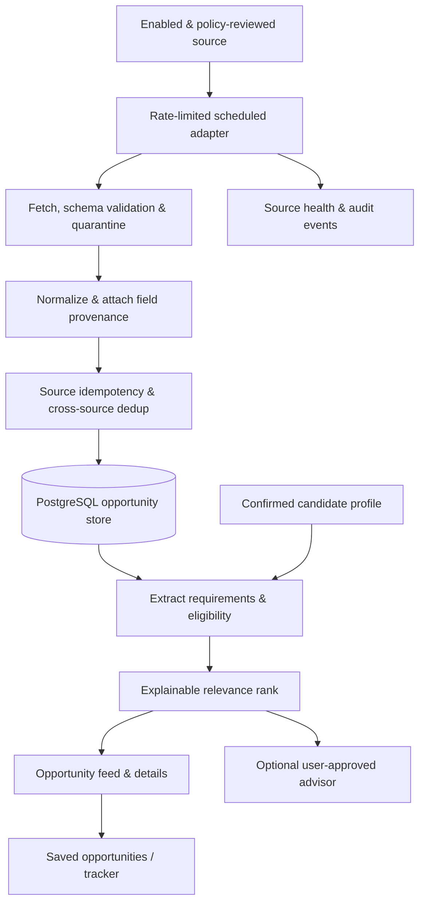

# CareerRadar — Product Requirements Document (PRD)

> **Product:** CareerRadar — Personal Career & Opportunity Intelligence System  
> **Version:** 0.1.0 (product-definition draft)  
> **Prepared:** 2026-10-27  
> **Status:** Draft — design baseline, not implementation authorization  
> **Document owner:** Project maintainer  
> **Primary deliverable:** Personal-first web application, designed for possible multi-user expansion  
> **Companion documents to create later:** `architecture.md`, `data-contracts.md`, `source-policy-register.md`, `test-plan.md`, `roadmap.md`

## 0. Decisions, assumptions, and reading guide

### Confirmed product requirements

1. Discover a **curated set** of employment opportunities from approved job boards, employer career pages, APIs, feeds, and other suitable sources.
2. Accept a user's CV (PDF/DOCX) **or pasted professional background**; extract skills, experience, education, projects, and certifications into an editable profile.
3. Determine whether an opportunity appears **eligible** for the user, separately assess its **relevance/fit**, and explain the evidence and uncertainties.
4. Track **when an opportunity was published**, when CareerRadar discovered and last verified it, whether it remains open, and the **official application deadline**, when available.
5. Provide accurate, personalized, **evidence-based resume tailoring suggestions** to improve an application without inventing credentials.
6. Support **jobs, fellowships/mentorships, and postgraduate scholarships/programmes**—not jobs alone.

### Working assumptions awaiting confirmation

- **A1 — Audience:** Build for one private user first; preserve clean domain boundaries for optional future multi-user support.
- **A2 — Scope:** All three categories exist in the MVP data model and user experience, but the number of automated source integrations can grow in phases; manual entry remains available for any category.
- **A3 — Autonomy:** Search, collect, normalize, assess, notify, and advise automatically where permitted; **never apply, send a CV, contact a recruiter, or alter a submitted application without explicit user action**.
- **A4 — Location:** Initial profile supports users resident in Zimbabwe, worldwide-remote opportunities, and relocation/sponsorship preferences. These are configurable, not hard-coded as universal assumptions.
- **A5 — Platform:** Web-first application. Local/private deployment is sufficient for the MVP; public hosting is optional.
- **A6 — AI:** A transparent rules-based matching baseline precedes semantic ranking and optional LLM explanations.
- **A7 — Compliance:** Source integrations activate only after verifying access method, relevant terms, attribution, retention, caching, rate limits, and display restrictions. No claim of legal clearance is implicit.

**Priority legend:** P0 = required for the MVP acceptance gate; P1 = first extension after validation; P2 = later/optional. Requirements with a P1/P2 label are **not** guaranteed for v1.

---

## 1. Executive summary

CareerRadar is a **personal career and opportunity intelligence system**, not a general-purpose job board. It continuously monitors an explicitly configured set of allowed sources and surfaces employment roles, technical fellowships/mentorships, and postgraduate scholarship opportunities that plausibly fit a candidate's qualifications, interests, location, and constraints.

Unlike keyword-based aggregators, CareerRadar must:

- Distinguish **mandatory eligibility** from **preference-based relevance**.
- Highlight **unknown/uncertain requirements** instead of fabricating eligibility.
- Preserve links and evidence from original notices.
- Understand that *remote* does not automatically mean *available to applicants in any country*.
- Give application advice grounded in verified user experience and the opportunity notice.
- Maintain an accurate, inspectable history of sources, discovery runs, changes, and application activity.

**Value proposition:** Spend less time searching scattered sites, miss fewer relevant and time-limited opportunities, and make better-informed application decisions.

## 2. Problem, goals, and non-goals

### 2.1 Problem statement

Relevant opportunities are fragmented among job platforms, company ATS pages, university admissions sites, open-source programme portals, and scholarship notices. Their requirements use inconsistent terminology and frequently omit vital data such as work-authorization rules or deadlines. Manual searching is repetitive; keyword matching over-selects unsuitable listings and overlooks semantically relevant roles. A CV alone also underrepresents a candidate's future interests.

### 2.2 Goals

- **G1 Discovery:** Aggregate a manageable, configurable set of relevant opportunities from authorized sources.
- **G2 Qualification:** Identify mandatory requirements, known evidence, missing evidence, and disqualifying conflicts with defensible reasoning.
- **G3 Ranking:** Prioritize relevant eligible and near-match opportunities without burying uncertainty.
- **G4 Timeliness:** Expose status and deadlines reliably; enable reminders for confirmed deadlines.
- **G5 Preparation:** Help users tailor applications without exaggeration or invented achievements.
- **G6 Workflow:** Track shortlisted opportunities, applications, and outcomes.
- **G7 Trust:** Preserve provenance, protect CV data, honor source rules, and make failed ingestion observable.
- **G8 Learning:** Measure quality so ranking and source selection can improve from actual feedback.

### 2.3 Out of scope for MVP

- Autonomous job/scholarship applications, form submission, and unattended communication with employers.
- Bulk CV submissions, deceptive credential generation, or auto-generated fake references.
- CAPTCHA bypass, credential abuse, hidden-site access, anti-bot evasion, or disallowed scraping.
- Guaranteeing employment, admission, sponsorship, funding, or acceptance.
- Full internet crawling or a comprehensive worldwide catalogue.
- Marketplace features for employers/recruiters, paid job advertisements, and public syndication of external listings.
- Native mobile apps, custom-trained ranking models, multi-tenant billing, and complex agent orchestration.

## 3. Target users and jobs to be done

### 3.1 Primary persona

**Early-career technical candidate:** Computer Engineering / Computer Science background; experience in software, data engineering, or AI; exploring entry-level/graduate employment, remote roles, overseas relocation, open-source fellowships, and funded postgraduate study. The product must permit different experience levels and academic profiles.

### 3.2 Later persona (not MVP scope)

**Other student, graduate, or professional:** Creates an isolated profile and receives their own recommendations. A later rollout requires proper authentication, privacy safeguards, tenant isolation, and configurable notification preferences.

### 3.3 Core user jobs

- “Tell me which relevant opportunities are open **for someone in my circumstances**.”
- “Explain which requirements I satisfy, which I lack, and which are unknown.”
- “Show me the original announcement and how recently you checked it.”
- “Alert me before a verified deadline without guessing a date.”
- “Show how to improve my CV for this specific opportunity using my real accomplishments.”
- “Help me organize applications and follow-ups across different programme types.”

## 4. Product principles

1. **Evidence over confidence:** A requirement assessment must link to candidate evidence and source text.
2. **Unknown is a valid result:** Absence of information does not imply eligibility, open status, unlimited remote access, or full funding.
3. **Source-first compliance:** Respect each provider's terms; robots.txt is one crawler signal, not blanket legal permission.
4. **Human control:** A user confirms profile data and controls application actions.
5. **Explainability before complexity:** Baseline deterministic matching first; model-driven ranking only when evaluated.
6. **Privacy by default:** Minimize, protect, and delete candidate data predictably.
7. **Observable automation:** Failures, skipped sources, freshness, and partial ingestion must be visible.
8. **Category-sensitive logic:** Jobs, fellowships, and scholarships share a core opportunity schema but have different eligibility rules.

---

## 5. Opportunity domain model

### 5.1 Shared Opportunity attributes

Required common fields:

| Attribute | Meaning / rule |
|---|---|
| `id` | Internal immutable UUID |
| `opportunity_type` | `JOB`, `FELLOWSHIP`, `SCHOLARSHIP` |
| `title` | Original or minimally normalized title |
| `organization_name` | Hiring entity, host, university, sponsor, or programme |
| `summary` | Sanitized, traceable summary; never invented |
| `canonical_url` | Original authoritative listing URL when available |
| `application_url` | Provider-approved application destination; preserve required redirects |
| `source_id`, `external_id` | Source identity and upstream listing identity if available |
| `source_attribution` | Display/clickthrough information required by provider |
| `application_cycle_id` | Distinguishes annually recurring programmes and reopened listings |
| `location`, `countries_allowed` | Location constraints, including explicit unknown states |
| `requirements` | Mandatory / preferred / unknown requirement objects |
| `posted_at` | Published date from source when provided; **nullable** |
| `first_seen_at` | First discovery by CareerRadar |
| `last_seen_at` | Most recent valid observation by source connector |
| `last_verified_at` | Most recent trustworthy check of the status |
| `opens_at`, `deadline_at` | Official application window information, **nullable** |
| `deadline_timezone`, `deadline_precision` | Exactness and timezone of known deadline |
| `status` | `OPEN`, `CLOSED`, `UPCOMING`, `UNKNOWN`, `STALE` |
| `evidence`, `field_provenance` | Field-level sources and extraction confidence |

Dates must distinguish **original publication**, **republication/update**, **first discovery**, and **verification**. `publishedAt` from an ATS must not automatically be relabeled as the first-ever posting date.

### 5.2 Job-specific fields

Job family; employment type; seniority; compensation and currency when explicitly published; onsite/hybrid/remote arrangement; eligible work countries; visa sponsorship and relocation support (yes/no/unknown); required work authorization; minimum experience; required skills/degree; application route.

### 5.3 Fellowship-specific fields

Programme/project name; organization; mentorship vs research vs professional fellowship; cohort and term; eligibility (student status, graduation window, experience, country); stipend/funding if published; contribution prerequisites; required time commitment; mentors/projects; application start/deadline; selection milestones.

### 5.4 Scholarship-specific fields

Host university; degree level (master's/PhD/etc.); field/research focus; scholarship programme and cohort; eligible nationality/residency; prior degree and grade requirements; language-test requirements; admission vs scholarship application pathways; tuition coverage; living stipend; travel/insurance coverage; funding conditions; required documents; academic and scholarship deadlines (which may differ).

**Funding representation:** `FULL`, `PARTIAL`, `NONE`, `UNKNOWN`, with detailed coverage fields. “Fully funded” must not be inferred from a marketing headline without corroborating programme details.

### 5.5 Recurring opportunities

A *programme* (e.g., a recurring annual fellowship) is a durable entity; an *application cycle* is a separate instance with its own dates, status, eligibility rules, and source evidence. Never copy last year's deadlines into a new cycle as confirmed dates. An `expected_cycle` or reminder-to-watch state may be labeled estimated.

---

## 6. Functional requirements

Each requirement has a stable identifier, priority, behavior, and acceptance criterion. This is the implementation checklist.

### 6.1 Profile onboarding and control

**FR-PRO-001 [P0] — CV/document upload.** Accept PDF and DOCX CVs. Check file type by content and extension, reject encrypted/unsupported/corrupt/oversized files, and enforce an admin-configurable maximum (default **10 MiB**). Extract text without executing embedded macros or active content.

- **Accept when:** A valid sample PDF and DOCX produce readable candidate text; malicious, corrupt, and oversized fixtures are rejected with actionable messages.

**FR-PRO-002 [P0] — Paste/manual entry.** Allow users to paste freeform profile text and manually enter skills, employment, education, certifications, projects, languages, links, and preferences without uploading a file.

- **Accept when:** A candidate can complete onboarding using only text or structured forms.

**FR-PRO-003 [P0] — Structured extraction and confirmation.** Parse supplied content into `CandidateProfile`, preserve evidence spans and extraction uncertainty, and present an editable confirmation screen. No extracted assertion becomes a confirmed qualification until user-approved.

- **Accept when:** The user can inspect, correct, add, remove, and save extracted profile fields; confirmed vs inferred status remains distinguishable.

**FR-PRO-004 [P0] — Search preferences.** Configure target roles/keywords, excluded roles, career interests, opportunity types, seniority, work modes, eligible countries, relocation interest, sponsorship requirements, degree level, research fields, funding threshold, and notification settings.

- **Accept when:** Preferences persist and materially affect discovery filters and ranking, without rewriting factual candidate history.

**FR-PRO-005 [P0] — Profile revisions.** Maintain `profile_version`; invalidate/recompute affected assessments after confirmed profile changes and identify which version produced a recommendation.

- **Accept when:** Editing a core qualification updates relevant evaluations without losing application history.

**FR-PRO-006 [P1] — Multiple CV variants.** Save named versions of a CV and associate the selected document with an application. Do not overwrite the original automatically.

### 6.2 Curated discovery and source registry

**FR-SRC-001 [P0] — Allowlisted source registry.** Each source records name, URL/domain, opportunity types, collection method (`API`, `RSS`, `HTML`, `MANUAL`), enabled state, ownership/maintainer, last policy review, attribution, allowed storage/display, permitted polling frequency, request limits, credentials, and failure state.

- **Accept when:** No source executes unless explicitly enabled with a completed policy checklist; sources can be paused immediately.

**FR-SRC-002 [P0] — Source adapters.** A common interface (`fetch`, `parse`, `validate`, `normalize`, `health`) permits provider-specific implementations; a provider failure does not halt healthy sources.

- **Accept when:** At least one documented job source is ingested end-to-end, and a manual/official-link path supports fellowship and scholarship records; adapters pass shared contract tests.

**FR-SRC-003 [P0] — Targeted discovery.** Apply saved search criteria via source-supported filters where possible and locally afterward. Do not make unrelated high-volume requests solely to build an exhaustive mirror.

- **Accept when:** Modifying a tracked keyword, organization, country, or opportunity category changes discovery scope as documented.

**FR-SRC-004 [P0] — Rate limits and responsible fetching.** Per-source bounded concurrency, request budgets, jittered retry/backoff, `429`/`Retry-After` handling, timeouts, conditional requests where supported, caching, and a configurable polling plan. No evasion of technical access restrictions.

- **Accept when:** Injected 429/5xx/timeouts produce bounded retries, no runaway loops, and a visible partial-failure status.

**FR-SRC-005 [P0] — Idempotent ingestion.** Validate payloads; avoid duplicates using `(source_id, external_id, application_cycle_id)` where available, canonical URL and similarity-based cross-source checks as secondary methods; preserve source identities and provenance.

- **Accept when:** The same fixture ingested repeatedly does not create duplicate source records or duplicate alerts.

**FR-SRC-006 [P0] — Provenance and source link preservation.** Store authoritative source URLs and field-level source metadata. Display required attribution and use the source-prescribed application URL where applicable.

- **Accept when:** Every opportunity has a source route, an audit trail, and a clear original-source action; required attribution appears in the UI.

**FR-SRC-007 [P0] — Permitted HTML extraction.** For sources without an API/feed, support only individually reviewed publicly accessible pages, respecting source terms, robots directives where applicable, and approved crawl policies; disallow login/captcha bypass. Mark the connector blocked if permission is uncertain.

- **Accept when:** An unapproved source cannot enter the scheduled crawler and blocked-source reasons are visible.

**FR-SRC-008 [P0] — Manual opportunity entry/import.** Allow pasting official URL and/or notice text to create a manually reviewed opportunity of any category; fetching the URL is optional and subject to the same safe-fetch and permission checks.

- **Accept when:** A scholarship without a machine-readable source can still be entered, matched, and tracked with provenance.

**FR-SRC-009 [P1] — Source expansion.** Add separately reviewed provider connectors (e.g., selected ATS employer boards, feeds, fellowship catalogues, university programme pages) without modifying core match logic.

**FR-SRC-010 [P1] — Source configuration UI.** Add, inspect, pause, and test a supported source from the dashboard. Complex new parsers still require code/review; a pasted URL must not be presented as universally scrapeable.

### 6.3 Normalization, status, and lifecycle

**FR-OPP-001 [P0] — Opportunity-specific schema validation.** Validate shared and subtype-specific fields, preserving unknown values rather than filling arbitrary defaults. Reject malformed records; quarantine suspicious ones for review.

**FR-OPP-002 [P0] — Date semantics.** Persist `posted_at`, `first_seen_at`, `last_seen_at`, `last_verified_at`, application opening/deadline dates, and provenance separately. Preserve timezone and precision; store UTC instants when an instant is known, and original date-only values where appropriate.

- **Accept when:** A posting with no stated deadline displays **Deadline unknown**, not a computed deadline. Updates never rewrite `first_seen_at`.

**FR-OPP-003 [P0] — Status and closure.** Track `OPEN`, `UPCOMING`, `CLOSED`, `UNKNOWN`, `STALE`. A verified closure/expiry may close a record; a failed or truncated ingestion **must not** be treated as evidence every missing opportunity closed.

- **Accept when:** A simulated partial API response does not close unseen records; a trusted closure signal updates only matching records.

**FR-OPP-004 [P0] — Deduplication/republication.** Merge confirmed duplicate representations while preserving provider-specific links and original records; keep distinct application cycles separate. Flag ambiguous similarity for review rather than destructively merging.

**FR-OPP-005 [P1] — Deadline changes and historical snapshots.** Detect source-proven changes to deadline, eligibility, or status; record old/new values; notify interested users about significant verified changes.

**FR-OPP-006 [P1] — Recurring programme watcher.** Track future cohort announcements and mark projected cycles as unconfirmed until verified from an official source.

### 6.4 Eligibility, match scoring, and explanations

**FR-MAT-001 [P0] — Requirement extraction.** Convert source text into structured requirements: category, mandatory/preferred/ambiguous, operator/threshold, normalized value, original text span, extraction method, and confidence.

- **Accept when:** Each automated assessment can point to the source passage supporting the requirement; conflicting passages are flagged.

**FR-MAT-002 [P0] — Ternary eligibility.** Assign `APPEARS_ELIGIBLE`, `INELIGIBLE`, or `NEEDS_VERIFICATION` using confirmed profile facts and verified mandatory requirements. At least one confirmed hard disqualifier implies `INELIGIBLE`; unresolved mandatory constraints imply `NEEDS_VERIFICATION` rather than presumed eligibility.

- **Accept when:** A remote US-only job is not labeled eligible for a Zimbabwe-based user solely because `remote=true`; no unspecified sponsorship is treated as confirmed.

**FR-MAT-003 [P0] — Category-aware rules.** Jobs assess work location/authorization, seniority, qualification and skills; fellowships assess cohort/student/contribution/time requirements; scholarships assess nationality, degree, academic/language admission criteria, funding requirements, and separate applications where applicable.

**FR-MAT-004 [P0] — Explainable fit ranking.** Compute a configurable **relevance score** distinct from eligibility. Initial factors: technical/academic fit, experience/level, interest, preference alignment, and source freshness. Store formula/weights and algorithm version.

- **Accept when:** Every score has a per-factor breakdown; the UI never equates a 95% score to a 95% chance of acceptance.

**FR-MAT-005 [P0] — Missing evidence and stretch opportunities.** Expose matched, partially matched, missing, conflicting, and unknown requirements. Allow a clearly labeled *stretch opportunity* view rather than eliminating roles with non-mandatory gaps.

**FR-MAT-006 [P0] — Verification workflow.** Present “Why this match?”, citation links, uncertain requirements, and suggested external questions (e.g., sponsorship eligibility). The user can flag an assessment as incorrect.

**FR-MAT-007 [P1] — Semantic retrieval.** Add embeddings/BM25 hybrid matching for job descriptions and skills, evaluated against a labeled baseline. Semantic similarity **never overrides** a confirmed hard eligibility restriction.

**FR-MAT-008 [P1] — Feedback-driven ranking.** Use saved, dismissed, relevant/irrelevant and applied feedback to adjust ranking only after checking for leakage, bias, and regressions; retain a transparent fallback.

### 6.5 Application advisor

**FR-ADV-001 [P0] — Evidence-based CV gap analysis.** Compare a confirmed profile/CV with the exact opportunity's requirements. Produce prioritized gaps and identify which are *missing on the CV* versus *not demonstrated by experience*.

**FR-ADV-002 [P0] — Tailoring suggestions.** Suggest more relevant project ordering, honest keywords, experience emphasis, bullet improvements, and document checklist. Ground each suggestion in (a) candidate evidence and (b) opportunity text.

- **Accept when:** The advisor does not invent numerical achievements, degrees, certifications, employers, dates, publications, languages, or immigration status. Missing metrics become explicit placeholders/questions.

**FR-ADV-003 [P0] — Human approval.** Suggestions appear as drafts for review/copy; no upload, external submission, external email, or silent CV replacement.

**FR-ADV-004 [P1] — Category-specific help.** Provide research-interest statement prompts, programme-fit analysis, transcript/reference checklists, scholarship statement structure, and technical interview topics where appropriate.

**FR-ADV-005 [P1] — CV versions/export.** Generate an editable tailored copy after user approval, record the source opportunity and version, and preserve the original unchanged.

### 6.6 Dashboard and workflow

**FR-UI-001 [P0] — Unified discovery feed.** Show opportunities with type, title, institution/employer, source, posted/first-seen dates, verification status, deadline, eligibility label, and score; expose original-source link.

**FR-UI-002 [P0] — Filters/saved searches.** Filter by opportunity type, role/field, country, remote/relocation, confirmed eligible vs needs review, source, funding, deadline, open/closed status, and score; sort by recency, deadline, and relevance.

**FR-UI-003 [P0] — Detail workspace.** Display verified description, requirements, eligibility rationale, score breakdown, missing data, timeline, source history, and application advice.

**FR-UI-004 [P0] — Bookmarks and application tracker.** Save opportunities, add notes, set states `DISCOVERED`, `SHORTLISTED`, `PREPARING`, `APPLIED`, `INTERVIEW`, `OFFER`, `REJECTED`, `WITHDRAWN`, `ARCHIVED`; allow category-specific milestones and manual date entry.

**FR-UI-005 [P0] — Source health.** Show last successful sync, current error, stale/paused sources, and whether a source is blocked pending compliance review.

**FR-UI-006 [P1] — Deadline calendar and reminders.** Support notifications for **verified** deadlines via configurable lead times; include time zone and source. Never notify an estimated date as an official deadline.

**FR-UI-007 [P1] — Digest notifications.** Opt-in email/in-app digest of newly matched and substantially changed opportunities; suppress duplicates and give an opt-out control.

**FR-UI-008 [P2] — Opportunity analytics.** Display application funnel, reason codes for discarded matches, source yield, and time-to-discovery trends.

### 6.7 Trust, privacy, and audit

**FR-TRU-001 [P0] — Secure candidate storage.** Restrict CV/profile access to the user, encrypt network connections, use secure storage permissions, minimize logs, and keep source documents private.

**FR-TRU-002 [P0] — External AI disclosure.** If an external model processes candidate text, show what information is sent, the provider, and offer a no-external-AI mode; obtain user permission before transmitting personal CV content.

**FR-TRU-003 [P0] — User deletion and retention.** Allow deletion of CVs, extracted text, profiles, and derived candidate-specific recommendations. Preserve only minimal operational records as justified by explicitly defined retention settings.

**FR-TRU-004 [P0] — Auditability.** Record significant profile edits, ingestion events, changes to source policies, eligibility evaluation versions, and user application status changes without exposing private CV text in log payloads.

**FR-TRU-005 [P1] — Account management for multi-user launch.** Authentication, authorization, tenant-scoped queries, per-user encryption/access checks, rate limits, and account export/deletion are a **release gate** before allowing more than one real user.

---

## 7. End-to-end user journeys

### Journey J1 — First-time onboarding

1. User opens the private app and sees its privacy/data-use notice.
2. User uploads a CV or pastes professional text.
3. System parses candidate facts, categorizing confirmed vs tentative extractions.
4. User edits and confirms facts.
5. User selects target careers and opportunity types, geographical and funding constraints.
6. System shows which sources are enabled, with their last verification status.
7. Initial discovery and matching run completes; feed distinguishes eligible/unknown/ineligible and shows evidence.

**Success:** User can identify at least one recommendation or a clear “no matches yet” explanation; no unsupported eligibility claims appear.

### Journey J2 — Finding an international remote role

1. User filters for remote AI/ML or Data Engineering jobs.
2. System separates explicit global-remote acceptance from country-restricted and unknown remote eligibility.
3. User opens a result to see work-country and sponsorship evidence.
4. User bookmarks, reviews CV gaps, and navigates to the approved application link.
5. User manually records application status.

**Success:** The UI never mislabels country-restricted remote jobs as universally eligible.

### Journey J3 — Fellowship/mentorship discovery

1. User follows selected technical mentorship programmes and projects.
2. Source adapter or manual entry records official cohort information and project prerequisites.
3. Eligibility evaluator checks student status, technical prerequisites, term, time commitment, and any nationality conditions.
4. User saves a programme and prepares its application checklist.

**Success:** An old cohort's application deadline is never represented as a new confirmed deadline.

### Journey J4 — Fully funded postgraduate study

1. User chooses master's/PhD field(s), target countries, and minimum funding preference.
2. System surfaces programmes from configured official sources.
3. Details distinguish admissions criteria, scholarship criteria, language requirements, tuition, stipend, and separate deadlines.
4. User receives an evidence-based fit analysis; missing admission rules are marked unknown.
5. User tracks references, documents, admission application, and funding application separately.

**Success:** Partial funding and unknown funding are not labeled “fully funded.”

### Journey J5 — Changing or closing opportunity

1. Scheduled sync obtains an updated source record.
2. Change detector compares trusted fields and updates history.
3. A trusted status signal marks closed/reopened; missing records in a failed run do not trigger closure.
4. The UI reflects verification time, change evidence, and optional notification.

**Success:** A transient outage does not erase saved opportunities or falsely close applications.

---

## 8. Source acquisition and compliance policy

### 8.1 Connector admission checklist (must be completed per source)

- [ ] Source identity, owner, official documentation, and API/feed/HTML access path established.
- [ ] Terms of use, scraping/access permissions, retention limits, display/attribution obligations and republishing restrictions reviewed.
- [ ] Robots directives respected where automated web crawling is applicable; **robots permission does not replace terms/licensing review**.
- [ ] Credential requirements and permitted account scope recorded; secrets reside server-side.
- [ ] Request budgets, polling intervals, pagination method, retries, conditional requests, and closure semantics documented.
- [ ] Required source link and exact Apply/Visit route retained.
- [ ] Source can be paused centrally; no attempts to bypass login, rate limits, captchas, or blocking.
- [ ] Minimal retained content and deletion/expiry handling defined.
- [ ] Test fixtures and expected schema mappings checked into tests only when licensing permits.

### 8.2 Candidate providers for investigation — **not automatically approved**

| Candidate source | Domain | Access starting point | Launch rule |
|---|---|---|---|
| Himalayas | Remote employment | Official remote-jobs API | Review API terms; honor attribution and mandated `applicationLink`; do not syndicate |
| Remotive | Remote employment | Official public API/RSS | Review API terms; honor attribution/linkback, data delay and redistribution limits |
| Greenhouse | Employer postings | Public Job Board GET API | Track **specific employers**; check permitted downstream use |
| Lever | Employer postings | Public postings API | Track **specific employers**; check regional endpoint and permitted use |
| Ashby | Employer postings | Public Job Postings API | Track **specific employers**; honor `isListed`/applicable publication rules |
| LFX / programme websites | Technical mentorships | Official programme pages/listings | Confirm exact page permission; programme-specific cohorts may vary |
| Erasmus Mundus catalogue / host institutions | Postgraduate scholarships | Official catalogue and university pages | Treat admission, funding, and deadlines as programme-specific |
| Other university/fellowship sites | Scholarship/fellowship | Official feeds or reviewed pages; otherwise manual entry | No universal crawler assumption |

**Provider policies are live external dependencies.** Do not hard-code unverified request limits into design requirements. Review each before activating the connector and revisit on material changes.

### 8.3 Collection method precedence

`Provider-approved API > provider-approved RSS/feed > reviewed public HTML extraction > user-assisted manual link/text entry`.

A general web search engine can assist **discovery of candidate sources**, but search results alone must not be treated as a verified, open, eligible, or licensed opportunity.

### 8.4 Source retention policy

Store only permitted attributes and for the permitted duration. The source registry must specify `retention_policy`, `attribution_policy`, `permitted_display_scope`, and expiry/removal behavior. If raw snapshots or full descriptions are prohibited, retain only allowed metadata, source pointers, and extraction outputs consistent with applicable terms. Provider policies supersede any convenient default retention setting.

---

## 9. Ingestion and opportunity lifecycle

### 9.1 Pipeline



### 9.2 Ingestion invariants

1. **No false closure:** Only a complete trustworthy snapshot or source-specific closure signal can drive absence-based closure, after any configured verification grace period.
2. **Idempotency:** Reprocessing an identical upstream record creates no new logical opportunity and no repeated notification.
3. **Checkpoint correctness:** Commit pagination cursor/checkpoint only after corresponding batch data is persisted transactionally.
4. **Partial failure isolation:** A failing source does not roll back successful independent sources or delete their prior data.
5. **Retry safety:** Backoff respects explicit provider instructions; retries cannot exceed per-source request budgets.
6. **Versioned normalization:** Preserve parser and extraction versions for reprocessing/debugging.
7. **Provenance continuity:** Every material normalized claim maps to a source response/page/notice or to a user-confirmed profile field.
8. **Freshness honesty:** If a source has not been checked successfully, display stale/unknown freshness instead of “open now.”
9. **Legal controls:** A source policy change can disable polling and remove/restrict retained content.

### 9.3 Discovery cadence

Set schedules **per provider**, never globally. Start at the provider's documented permitted cadence (or a more conservative interval), cache effectively, and back off on failures. For feeds updated only daily, aggressive minute-level polling adds load with little benefit. Manual refresh must obey the same budget and cannot override source policy.

### 9.4 Deduplication

- **Level 1:** Strong source key: `(source_id, external_id, cycle_key)`.
- **Level 2:** Canonicalized URL and official organization/job reference.
- **Level 3:** Candidate similarities: organization + normalized title + location + description fingerprint + cycle dates.
- **Decision:** Merge automatically only above a carefully validated threshold; otherwise propose possible duplicates for manual review. Preserve all original source links and source-specific instructions.

### 9.5 Date/time handling

- Preserve provider-local strings and date precision in raw provenance.
- Convert complete timestamps to UTC, with the original timezone retained; do not silently assume UTC for missing offsets.
- For date-only deadlines, preserve a **date-only** representation unless the source declares a cutoff timezone/time; avoid claiming “11:59 PM” automatically.
- Treat deadlines as changing facts: record when a field changed and how it was verified.
- Label `posted_at = unknown` rather than substituting `first_seen_at` in its place.

---

## 10. Matching, eligibility, and recommendation design

### 10.1 Separation of concerns

**Layer A — Search relevance:** Does the opportunity fall within selected tracks, topics, institutions, and preferences?  
**Layer B — Mandatory eligibility:** Do confirmed facts satisfy or conflict with hard requirements?  
**Layer C — Competitive fit:** How well do the candidate's demonstrated skills, experience, achievements, and interests align?  
**Layer D — Application guidance:** Which truthful improvements or clarifications would strengthen preparation?

### 10.2 Eligibility evaluation contract

Each `RequirementAssessment` contains:

- `requirement_id`, `opportunity_id`, `requirement_type`, `importance`
- `source_quote_or_span`, `source_url`, `extraction_method`, `extraction_confidence`
- `candidate_evidence_ref` (or null), `assessment`: `MATCH`, `GAP`, `CONFLICT`, `UNKNOWN`, `NOT_APPLICABLE`
- `reason`, `rule_version`, `evaluated_at`

Suggested top-level evaluator:

```text
if any verified mandatory requirement has a confirmed disqualifying conflict:
    INELIGIBLE
else if any material mandatory requirement lacks trustworthy evidence:
    NEEDS_VERIFICATION
else:
    APPEARS_ELIGIBLE
```

A preference mismatch is not automatically disqualifying. Do not infer legal work authorization, sponsorship, or nationality from a CV unless explicitly confirmed as relevant by the user. An official source may have unlisted requirements; the label **APPEARS_ELIGIBLE** is always provisional.

### 10.3 Baseline fit score

For MVP, use a configurable weighted score over **known, explainable** factors, e.g. technical/academic qualifications **40%**, experience level **25%**, target interests **20%**, working/study preferences **10%**, freshness **5%**. These are **initial hypotheses to validate**, not objective success probabilities or universal scholarship weights.

Implement category-specific features and missing-data normalization: do not score a scholarship down solely because salary is absent or an employer up because a required academic transcript is unknown. Present components and a qualitative label; keep eligibility visibly independent.

### 10.4 Evaluation protocol

- Create a manually labeled dataset covering **jobs, fellowships, scholarships**, restricted remote roles, incomplete eligibility, deadlines, duplicates, and recurring cycles.
- Measure Precision@10/20, NDCG@10, reviewer agreement, false-eligibility rate, and rate of unsupported explanations.
- Compare rules-only with BM25/embedding/LLM variants before rollout.
- Keep a holdout set and version each model, prompt, schema, and scoring rule.
- No training on CVs or user feedback without explicit authorization and a clear privacy policy.

### 10.5 AI and prompt-safety controls

External source text is **untrusted**. Treat listings and imported HTML as data, not instructions. Isolate model instructions from fetched content, validate structured output against typed schemas, require evidence references, block arbitrary tool execution from scraped text, avoid leaking CV/PII, and fall back to deterministic rules if extraction is unreliable. User must be able to disable LLM features without losing core discovery, filtering, and tracking.

---

## 11. UX and information architecture

### 11.1 Core navigation

1. **Overview:** Newly discovered opportunities, upcoming verified deadlines, source health, and application pipeline.
2. **Discover:** Search and faceted filters; unified feed with category-specific badges/attributes.
3. **Opportunity details:** Source, requirements, eligibility, fit, dates, funding/compensation, original link, and advisor panel.
4. **Saved & Applications:** Personal kanban/list, notes, deadlines, status, submitted CV version (later).
5. **My Profile:** CV import, extracted evidence, skills, education, projects, preferences, privacy controls.
6. **Sources:** Enabled providers, source policies, last-run health, tracked employers/programmes.
7. **Settings:** Scheduling, alerts, AI permissions, data deletion, theme/accessibility.

### 11.2 Feed-card minimum content

Opportunity title, organization, type, explicit location mode, eligibility state, match label/score, `posted_at` or “Unknown”, deadline or “Unknown”, verification timestamp, source attribution, save button, and official application/visit link. High fit and eligibility uncertainty must both be visible; do not bury uncertainty behind a large score.

### 11.3 Empty, error, and stale states

- **No matches:** Show active filters, last sync, and option to broaden criteria or add manual opportunities.
- **Source unavailable:** Show cached results labeled stale, do not claim “no opportunities.”
- **Ingestion paused:** Explain source policy or technical reason.
- **Unknown eligibility:** Provide the exact missing information and a route to verify.
- **Unknown deadline:** No fabricated countdown and no deadline alert.

### 11.4 Accessibility

Keyboard navigation, semantic controls, sufficient contrast, visible focus, screen-reader labels, text equivalents for status colors, and responsive layouts. Target WCAG 2.2 AA where practical for the web MVP.

---

## 12. Proposed technical architecture

### 12.1 Architecture choice

**Recommended:** Modular monolith (backend) + independent scheduled ingestion worker + single PostgreSQL database + React client. Use clear module boundaries; deploy together via Docker Compose initially. This minimizes operational overhead while preserving future separation into services.

**Alternative:** A distributed queue with separately deployed crawlers and matching services. Use only if source count, throughput, availability, or independent scaling demonstrably requires it; otherwise it adds networking, message ordering, retries, and operational failure modes.

### 12.2 Recommended components

| Layer | Candidate technology | Responsibility |
|---|---|---|
| Client | React + TypeScript + Vite | Dashboard, profile review, trackers, source management |
| UI styling | Tailwind CSS + accessible components | Responsive, consistent interface |
| HTTP API | Python FastAPI + Pydantic | Validation, orchestration, REST APIs |
| Storage | PostgreSQL | Users, structured profile, sources, opportunities, match results, applications, audit |
| Migrations | Alembic | Version-controlled database schema |
| Acquisition | Python HTTPX + provider adapters | External APIs and permitted feeds/pages |
| Scheduling | Dedicated cron/APScheduler process | Per-source scheduled jobs; no per-request background fire-and-forget |
| Parsing | Safe PDF/DOCX text libraries | CV extraction and candidate confirmation |
| Baseline NLP | Python + scikit-learn / lexical features | Transparent matching and testing |
| Semantic matching (P1) | Sentence Transformers / optional pgvector | Context-aware retrieval after evaluation |
| AI advisor (optional) | Configurable model provider / local model | Bounded evidence-based drafting |
| Deployment | Docker Compose | Repeatable local/private deployment |
| Monitoring | Structured logs, health endpoints, metrics | Sync and workflow observability |

**Do not require:** Kubernetes, Kafka, distributed microservices, a vector database, or an autonomous agent framework for the MVP.

### 12.3 Logical module boundaries

`identity/profile`, `sources/policies`, `ingestion`, `opportunities`, `requirements`, `eligibility`, `ranking`, `advisor`, `applications`, `notifications`, `audit`.

Keep request/response schemas and database models separate from provider-specific payload models. Use migrations; define transactional boundaries around an ingestion batch and checkpoint.

### 12.4 Suggested repository layout

```text
careerradar/
  frontend/
    src/features/{discover,opportunities,profile,applications,sources,settings}/
  backend/
    app/
      api/
      core/
      db/
      domain/{profile,opportunities,matching,applications}/
      ingestion/{adapters,normalize,policies,worker}/
      services/{advisor,notifications,audit}/
      schemas/
    migrations/
    tests/{unit,integration,contracts,fixtures,security}/
  infrastructure/
    docker-compose.yml
  docs/
    prd.md
    source-policy-register.md
    architecture.md
    decisions/
  .env.example
  README.md
```

---

## 13. Conceptual data design

| Table/entity | Minimum meaningful fields / relationships |
|---|---|
| `users` | Internal ID, preference defaults, future auth/tenant support |
| `candidate_profiles` | `user_id`, confirmed bio, profile version, consent metadata |
| `candidate_evidence` | Source CV/text/user entry, skill/claim, provenance, confirmed flag |
| `documents` | Owner, type, private blob pointer, hash, version, deletion state |
| `career_preferences` | Roles, interests, geographies, funding, seniority, restrictions |
| `sources` | Provider type, URL, enabled, policy state, request configuration |
| `source_policies` | Terms reference, permissions, attribution, retention, reviewed_at |
| `source_runs` | Start/end, status, cursor, attempted/successful counts, error code |
| `source_records` | `(source_id, external_id)`, provider URL, fingerprint, retention metadata |
| `opportunities` | Type, canonical title/organization, status, core fields |
| `application_cycles` | Programme/listing cycle, opening/closing, cohort, status |
| `opportunity_sources` | Many-to-many mapping to raw/provider records and URLs |
| `requirements` | Type, hard/preferred, normalized value, source evidence |
| `field_evidence` | Claim key, source URI/span, extraction version, verified_at |
| `match_results` | Profile version, opportunity/cycle, eligibility, score, rule/model version |
| `requirement_assessments` | Requirement-to-candidate evidence, outcome, rationale |
| `saved_opportunities` | User, cycle, bookmark and notes |
| `applications` | User, cycle, status, applied_at, document version, follow-up |
| `application_events` | Timestamped application state transitions and user notes |
| `notifications` | User, opportunity/cycle, event key, sent_at, dedup key |
| `audit_events` | Actor, action, target, timestamp, minimal privacy-safe metadata |

**Schema constraints:** UUID primary keys; unique `(source_id, external_id[, cycle_id])` as supported; unique dedup notification event keys; foreign-key cascade rules explicitly reviewed for privacy deletion; indexed queries for type/status/deadline/profile, and document hashes for duplicate uploads. Not every opportunity will have an upstream ID or reliable timestamp, so missing values need first-class handling.

### Data retention / deletion strategy

- Retain user-provided CV files and extracted profile content only while needed and user-permitted; support explicit deletion.
- Keep raw source data only if the specific provider policy allows it; set time-bound purge jobs where needed.
- Apply private files' access controls separately from public opportunity records.
- On deletion, remove or anonymize candidate-derived match results, advice, and document pointers according to a documented cascade policy.
- Use backups with tested recovery and a stated expiry policy; warn that deletion from backups may be subject to bounded backup retention.

---

## 14. Initial REST API contract (proposed, subject to detailed API design)

| Method | Path | Purpose |
|---|---|---|
| `POST` | `/api/v1/profile/import` | Submit supported CV or pasted profile text for parsing |
| `GET/PUT` | `/api/v1/profile` | View / confirm / edit candidate profile |
| `GET/PUT` | `/api/v1/preferences` | Read / update search preferences |
| `GET` | `/api/v1/sources` | List sources, policy state and sync health |
| `POST` | `/api/v1/sources` | Register reviewed source configuration |
| `POST` | `/api/v1/sources/{id}/sync` | Request sync within policy limits; privileged action |
| `GET` | `/api/v1/opportunities` | Filtered/paginated search |
| `POST` | `/api/v1/opportunities/manual` | Create reviewed/manual opportunity |
| `GET` | `/api/v1/opportunities/{id}` | Full detail, evidence, links, cycles and changes |
| `GET` | `/api/v1/opportunities/{id}/match` | Eligibility and relevance explanation |
| `POST` | `/api/v1/opportunities/{id}/assess` | Evaluate against latest confirmed profile |
| `POST` | `/api/v1/opportunities/{id}/advice` | Generate bounded, user-requested CV suggestions |
| `POST/GET` | `/api/v1/saved` | Save/list bookmarked opportunities |
| `POST/GET/PATCH` | `/api/v1/applications` | Create/list/update application records |
| `GET` | `/api/v1/ingestion/runs` | Recent runs and source errors |
| `DELETE` | `/api/v1/profile/data` | User-requested candidate-data deletion |

Provide pagination and validation error envelopes; secure all write endpoints. This table is a **design proposal**, not a fixed external contract.

---

## 15. Nonfunctional requirements and operational SLO targets

These are engineering **targets for validation**, not measured production guarantees.

| ID | Property | Proposed target / constraint | How to verify |
|---|---|---|---|
| NFR-01 | Correctness | No confirmed disqualifier labeled eligible in golden test suite; unknown mandatory facts remain unknown | Golden rule tests + manual review |
| NFR-02 | Idempotency | 0 logical duplicates from reprocessing identical fixture batches | Re-run integration fixtures |
| NFR-03 | Reliability | Ingestion failures cannot destroy previously committed data or falsely close listings | Partial-failure / database fault tests |
| NFR-04 | Source limits | No client-side breach of configured source request ceilings in stress tests | Rate-limit simulation and request counters |
| NFR-05 | API speed | p95 under **500 ms** for cached paginated browse on development-sized seeded data, excluding external source and LLM calls | Performance tests |
| NFR-06 | UI usability | Main discovery screen usable at mobile and desktop widths; keyboard-accessible | Manual and automated accessibility checks |
| NFR-07 | Data freshness | Each source displays last successful check and per-source next expected check; stale sources clearly labeled | Clock-controlled tests |
| NFR-08 | Security | No unauthenticated access to private CV files in a deployed instance; no secrets committed | Threat modeling + automated tests |
| NFR-09 | Observability | Every ingestion run carries ID, status, counts, duration, and sanitized failure reason | Log/DB inspection |
| NFR-10 | Recovery | Restorable local DB backup and reproducible environment configuration | Restore drill |
| NFR-11 | Maintainability | Connector contract tests, migrations, lint/type checking, CI gates | CI test suite |
| NFR-12 | Cost | MVP runs on a developer laptop without mandatory paid APIs or GPU inference | Local install and cost review |

**Security minimums:** request validation, authentication where deployed, server-side secrets, strict outbound host allowlists and DNS/IP revalidation to prevent SSRF, no internal-network fetches from user URLs, safe HTML rendering to prevent XSS, secure file handling, secure logging, dependency updates, and signed/approved deployment configuration as appropriate.

---

## 16. Testing and acceptance scenarios

### 16.1 Test pyramid

- **Unit tests:** Validators, date parsing, policy checks, score formulae, eligibility rules, requirement comparisons.
- **Provider contract tests:** JSON/HTML fixtures, pagination, optional fields, provider-specific links, schema evolution.
- **Integration tests:** Database migrations, transactions, upsert and dedup, checkpoint safety, parsing-to-ranking flow.
- **Security tests:** Malformed CVs, malicious HTML, prompt-injected listings, SSRF URLs, unauthorized file access, secrets/log redaction.
- **UI/E2E tests:** Onboarding, filtering, bookmarks, unknown state, advisory review, application status history.
- **Quality evaluation:** Small human-labeled multi-category sample with genuine positive/negative/unknown cases.

### 16.2 P0 acceptance scenarios (release blockers)

| Scenario ID | Given / when | Expected |
|---|---|---|
| AC-01 | Valid PDF or DOCX uploaded | Extracted evidence is shown for explicit user confirmation |
| AC-02 | User pastes profile text only | Full onboarding and recommendations possible without upload |
| AC-03 | Same API data ingested twice | No duplicate source opportunity or alert |
| AC-04 | API returns 429 with retry instructions | Client obeys rate budget and retries safely |
| AC-05 | Sync fails mid-pagination | Prior records remain; cursor not advanced beyond committed data |
| AC-06 | Opportunity missing from incomplete listing response | It is not marked closed solely due to absence |
| AC-07 | Remote posting restricted to another country | Not “eligible” for user in excluded country |
| AC-08 | Sponsorship requirements absent | Status is unknown/needs verification, not guaranteed |
| AC-09 | Posting does not provide deadline | UI says “Deadline unknown,” with no invented countdown |
| AC-10 | Past-year fellowship reused | New year is a distinct, unconfirmed cycle until official details arrive |
| AC-11 | Scholarship says “partial award” | Funding shown partial, not fully funded |
| AC-12 | Opportunity has a high fit score but hard disqualifier | Eligibility still shows ineligible; score never overrides it |
| AC-13 | User asks to improve CV | Advice only references substantiated experience; no false metrics |
| AC-14 | Opportunity origin requires attribution/redirect | Attribution and required link are retained on cards/details |
| AC-15 | User pastes malicious external URL or HTML | No internal network access or script execution |
| AC-16 | User deletes CV/profile | Private documents and derived profile data deleted per policy |
| AC-17 | One external source becomes unavailable | Remaining sources and saved records still usable; failed source shown stale |
| AC-18 | Manually entered scholarship | Can be tracked and matched with official URL and unknown fields |
| AC-19 | User edits verified skill/degree | Assessment version reflects updated candidate profile |
| AC-20 | App relaunched after restart | Durable data and saved application states are retained |

### 16.3 MVP definition of done

All P0 requirements and AC-01 through AC-20 must pass, documented source permissions must exist for enabled automated connectors, user privacy controls must function, and at least one real permitted **job** connector must run end-to-end. Fellowship and scholarship workflows must work through verified/manual notices even if their automated connectors are phased in. Benchmark baseline retrieval and eligibility quality on a labeled sample before introducing opaque ranking models.

---

## 17. Delivery plan, dependencies, and exit gates

### Phase 0 — Product and feasibility gate

**Work:** Confirm A1–A7; select permitted starter sources; write source-policy register; model job/fellowship/scholarship cases and eligibility semantics; collect representative test notices.

**Exit:** At least one job source has reviewed access terms; sample notices for all three categories; dated architecture and schema decisions; scoped MVP backlog.

### Phase 1 — Engineering foundation

**Work:** Repository and CI, FastAPI, PostgreSQL/Alembic, React scaffold, Docker Compose, structured logging, secret management, core domain tables, migration tests.

**Exit:** Reproducible local run, test data persists across restart, baseline CI passes.

### Phase 2 — Acquisition and opportunity records

**Work:** Source registry/policy controls, first API adapter, scheduled bounded ingestion, parser contracts, normalization, first-seen/posted/deadline handling, dedup, manual entry, source health, core listing endpoints.

**Exit:** Identical sync is idempotent; failed partial sync does not corrupt/close records; manual scholarship and fellowship can be entered.

### Phase 3 — Candidate intelligence

**Work:** CV upload/paste, structured extraction, user confirmation, profile versioning, typed requirements, rules-based eligibility, baseline fit score and evidence explanations.

**Exit:** Jobs, fellowships, and scholarships run through separate eligibility logic; remote country restrictions and unknown funding are correctly handled.

### Phase 4 — Usable personal product

**Work:** Full dashboard, search/filter, opportunity details, saved items, applications, advisor drafts, privacy/deletion UI, acceptance suite, documentation.

**Exit:** All P0 scenarios pass with no unresolved critical risks. **MVP release candidate.**

### Phase 5 — Measured enhancements (P1)

**Work:** More reviewed sources, verified-deadline reminders, digests, semantic retrieval, recurring cohort watch, richer application checklists, CV versions.

**Exit:** Empirical improvement over baseline on Precision@K without an eligibility regression; reliable notification dedup and source compliance.

### Phase 6 — Optional multi-user release (P2)

**Work:** Auth, account isolation, concurrency quotas, privacy terms, operational monitoring, abuse prevention, public deployment.

**Exit:** Explicit security/privacy review and tenancy tests; not part of current MVP commitment.

**Build order rule:** Backend data correctness and source policy checks before ML sophistication; eligibility and provenance before alerting; user controls before enabling an external LLM.

---

## 18. Product metrics and measurement plan

### Primary user-value metrics

- **Precision@10 and Precision@20:** Percentage of recommended top-K opportunities reviewed as relevant by the user.
- **Eligible recommendation precision:** Percentage of “appears eligible” listings without demonstrated disqualifying contradictions during sampled review.
- **Actionable discoveries per week:** New unique opportunities the user saves, considers, or applies to.
- **Deadline usefulness:** Count and proportion of confirmed important deadlines surfaced with adequate lead time.
- **Application throughput:** Shortlisted → preparing → applied transitions; avoid interpreting this as guaranteed career progress.

### Data and system health metrics

- Source sync success rate, age since successful sync, source latency, rate-limit responses, and records ingested.
- Duplicate/false-merge rate, invalid-record rate, provenance coverage, posting/closing change counts.
- Share of listings with **unknown** location eligibility, funding, and deadlines (tracked, not silently forced to zero).
- AI advice groundedness: percentage of suggestions supported by known profile and opportunity evidence.
- Manual false-positive/false-negative feedback and evaluation regression history.

**Initial success criterion:** The user can repeatedly find *new, clearly sourced, relevant opportunities* and make decisions faster than their existing manual workflow. Set numerical quality targets after a representative baseline dataset is collected, rather than inventing metrics now.

---

## 19. Risks, severity, and mitigations

| Severity | Risk | Mechanism / effect | Mitigation |
|---|---|---|---|
| Critical | Unapproved scraping or republishing | Source policy violation, blocked access, removal obligation | Source admission checklist, disabled-by-default connectors, retention enforcement |
| Critical | False eligibility certainty | Candidate wastes time or misses suitable roles | Ternary outcomes, mandatory-constraint tests, evidence links, correction workflow |
| Critical | Candidate data exposure | CV contains sensitive personal contact and career details | Access control, secure file storage, minimal logging, deletion controls |
| Major | False deadline or open-state claim | Missed application or invalid notification | Field provenance, precise date semantics, unknown/stale states |
| Major | Partial ingestion causes mass closure | Normal API outage appears as mass expiry | Snapshot completeness, delayed reconciliation, transactional checkpoints |
| Major | Incorrect cross-source merge | Two distinct postings/cycles collapsed | Conservative merge policy, reversible links, human review |
| Major | Prompt injection in a listing | External instructions influence an AI model or tool | Untrusted source boundary, schema validation, no arbitrary tool privileges |
| Major | Unstable HTML parsers | Layout changes silently lose records | Contract tests, alarms, schema validation, fallback manual entry |
| Major | Source bias and narrow coverage | Genuine opportunities never collected | Explicit source coverage dashboard and manual source suggestions |
| Minor | Opaque ranking and stale embeddings | Poor or difficult-to-debug recommendations | Versioned scores, human review, baseline comparator |
| Minor | Over-engineering | Project stagnates under infrastructure complexity | Modular monolith, small source set, release gates |

---

## 20. Open questions and required product decisions

Do not silently substitute implementation guesses for decisions. Resolve in a design log.

| ID | Question | Proposed default |
|---|---|---|
| D-01 | Personal-only or multi-user on first launch? | Personal-only MVP, secure multi-user extensibility |
| D-02 | Categories shipped together? | Data model/UI for all three, automated connectors phased |
| D-03 | Which first five sources and exact tracked employers/programmes? | Choose after access/terms review; one job API first |
| D-04 | Should personal profile explicitly include nationality and work authorization? | Optional, user-entered and privacy-controlled, never inferred |
| D-05 | What counts as a hard vs preferred requirement by category? | Rule catalog with documented evidence and user overrides |
| D-06 | Which scholarship fields are mandatory to display a funding label? | Explicit tuition/stipend/coverage evidence or UNKNOWN |
| D-07 | Should restricted but high-fit roles appear in feed? | Yes, separate clearly labeled “ineligible” and “stretch” filters |
| D-08 | What should be the initial notification channel? | In-app first, opt-in email later |
| D-09 | Which LLM deployment and data-handling policy? | Local or disabled by default; external only with consent |
| D-10 | What is the fallback when deadlines, language rules, or sponsor terms are ambiguous? | `NEEDS_VERIFICATION` with cited missing fields |
| D-11 | What retention period is permissible for each provider? | Source-specific written policy, no universal assumption |
| D-12 | Hosting and operational cost ceiling? | Local Docker Compose, no required paid service |
| D-13 | Which uploaded file formats beyond PDF/DOCX? | Defer until requested; pasted text covers fallback |
| D-14 | Which user inputs should remain mandatory vs optional? | Minimal onboarding plus explicit confirmation of restrictions |

---

## 21. Glossary

- **Opportunity:** A generic job, fellowship, or scholarship notice.
- **Application cycle:** A particular intake or published opening of a recurring opportunity.
- **Source registry:** Explicit allowlist of monitored providers and their access policies.
- **Provenance:** Evidence and traceability of a displayed claim to a source notice or confirmed profile fact.
- **Eligibility:** Provisional assessment of explicit mandatory conditions, not a prediction of acceptance.
- **Relevance/fit:** Compatibility with interests, qualifications, and preferences; not equivalent to eligibility.
- **Stretch opportunity:** Relevant opportunity with known gaps; not disguised as fully qualified.
- **Unknown:** Information cannot be established reliably from available evidence.
- **Stale:** Source/listing has not been successfully verified within the configured freshness interval.
- **Idempotent ingestion:** Repeating the same input does not create duplicate logical state.

## 22. Reference sources and verification notes

**Reviewed on 2026-10-27; re-check before implementation because API behavior, licensing, rate limits, and programme schedules can change.** This list is a technical starting point, **not** a legal opinion or blanket approval for collection.

1. **Himalayas Remote Jobs API** — https://himalayas.app/api — search/browse and API access. API terms: https://himalayas.app/terms — attribution, mandated original application links and redistribution restrictions.
2. **Remotive Public API** — https://remotive.com/remote-jobs/api — attribution, delayed listings, limitations on redistribution.
3. **Greenhouse Job Board API** — https://docs.greenhouse.io/job-board — public GET job-posting endpoints.
4. **Lever Postings API** — https://github.com/lever/postings-api — company-scoped postings and application URLs.
5. **Ashby Public Job Posting API** — https://developers.ashbyhq.com/docs/public-job-posting-api — published job board data and publication dates.
6. **Google JobPosting structured data documentation** — https://developers.google.com/search/docs/appearance/structured-data/job-posting — datePosted, validThrough, jobLocationType and applicantLocationRequirements semantics.
7. **Erasmus Mundus Joint Masters** — https://erasmus-plus.ec.europa.eu/opportunities/individuals/students/erasmus-mundus-joint-masters — programme catalogue and programme-specific applications.
8. **Linux Foundation mentorship schedule** — https://docs.linuxfoundation.org/lfx/mentorship/mentorship-program-timelines — recurring terms with programme-specific variations.
9. **Robots Exclusion Protocol, RFC 9309** — https://www.rfc-editor.org/rfc/rfc9309.html — machine-readable crawler access directives.

---

## 23. Approval criteria for turning this draft into an implementation plan

This PRD becomes **v1.0 approved for MVP build** after:

- [ ] D-01 through D-05 are answered and recorded in architecture decision records.
- [ ] A compliant initial source and its provider-specific source policy are recorded.
- [ ] The candidate data and external-AI consent policy are chosen.
- [ ] Golden test cases cover all three opportunity types, including uncertainty and disqualification examples.
- [ ] P0 scope and release gates are approved; P1/P2 items remain explicitly deferred.
- [ ] Implementation issues map back to stable FR/NFR/AC identifiers.

**Final product boundary:** CareerRadar is a **decision-support and workflow tool**. It finds and analyzes published opportunities, but it does not determine official applicant eligibility, make admission decisions, or submit applications autonomously.
